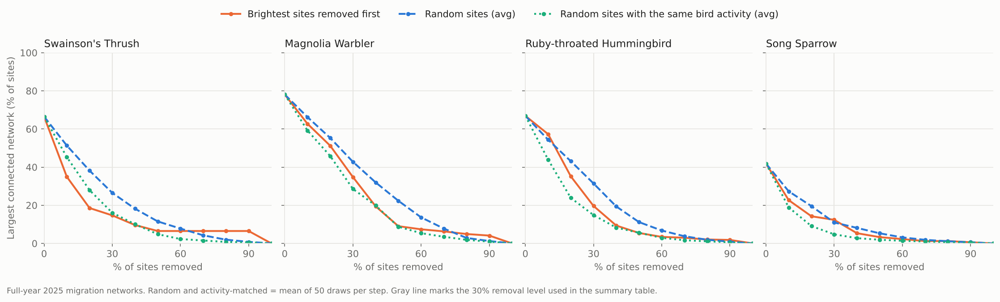

# Bird Migration Network Visualizer

An interactive tool that models North American bird migration as a network and tests whether stopover sites exposed to artificial light at night (ALAN) are structurally critical to that network — i.e., whether losing them would fragment migration connectivity more than losing random sites.

**[Live Demo →](https://bird-migration-tau.vercel.app/)**

## The Research Question

Prior research shows artificial light at night is a strong predictor of where birds stop over during migration, and that it alters nocturnal migration behavior. What's less understood is whether migration *networks* become structurally dependent on those brightly-lit sites — whether disrupting them (through further development, or conservation intervention) would fragment connectivity more severely than losing an equivalent number of random sites.

This project builds a migration network from real observation data, then runs stress tests comparing two disruption scenarios:
1. Removing the brightest (most light-polluted) stopover sites first
2. Removing an equivalent number of random sites

...and measures how much each scenario fragments the network.

## Approach

1. **Bird observations** are pulled from the eBird Basic Dataset and aggregated onto an H3 hexagonal grid (~city-sized cells), grouped by month, for 4 species over 2024–2026.
2. **Nightlight exposure** comes from NASA VIIRS Black Marble monthly composites, aggregated to the same H3 grid and averaged per year (light pollution at a location is a chronic, stable property — an annual estimate avoids noise from transient cloud/snow cover in any single month).
3. **The migration network** treats each (H3 cell, month) as a node and infers directed edges from month *t* to month *t+1*, weighted by `(source activity × target activity) / distance`, keeping only edges that rank in both their source's and target's top-10 strongest connections.
4. **Stress testing** removes nodes from this network — manually, or automatically by brightness vs. randomly — and tracks how the largest connected component and fragmentation rate respond.

Full methodology, database schema, and API reference are in [DOCUMENTATION.md](DOCUMENTATION.md).

## Key Findings

**Bright stopover sites look more important than random ones, but only because they are busier. Against random sites with the same bird activity, removing the brightest sites does no extra damage in any of the 8 full species-years tested.**

These results come from the Experiments view, run offline on the full-year 2025 network (H3 cells merged into ~65 km regions, all 12 months combined). Each removal column shows how much of the network stays connected after removing 30% of its sites:

| Species | Sites | Before removal | Brightest 30% removed | Random 30% removed | Random, same bird activity |
|---|---:|---:|---:|---:|---:|
| Swainson's Thrush | 415 | 67% | **15%** | 27% (p = 0.015) | 17% (p = 0.35) |
| Magnolia Warbler | 365 | 78% | **35%** | 43% (p = 0.04) | 31% (p = 0.68) |
| Ruby-throated Hummingbird | 438 | 67% | **20%** | 29% (p = 0.17) | 14% (p = 0.85) |
| Song Sparrow | 485 | 42% | **12%** | 11% (p = 0.72) | 5% (p = 1.0) |

*Percentages are the share of sites in the largest connected part of the network. "Random" is the mean of 200 random removals. "Random, same bird activity" is the mean of 500 removals that each draw random sites in the same activity deciles as the brightest 30%. Each p is the share of those draws that fragmented the network at least as much as removing the brightest sites.*



- **Against plain random removal, bright sites look important** for the long-distance migrants. For Swainson's Thrush, removing the brightest 30% leaves 15% of the network connected, against 27% after random removal. Magnolia Warbler shows the same pattern more weakly. The hummingbird points the same way, but the gap is within the range random removal produces.
- **That comparison is confounded.** Brightness and bird activity are correlated (Spearman ρ ≈ 0.5), and the network's busiest sites are its hubs: removing the busiest 30% leaves just 3–12% connected. eBird also over-samples places where people live, which are the bright places.
- **Once activity is matched, the effect disappears.** Removing random sites with the same activity profile as the brightest ones does comparable damage. For Magnolia Warbler, the hummingbird and Song Sparrow it does more; for Swainson's Thrush slightly less, but well within chance. In all 8 species-years (2024 and 2025), the brightest sites are never significantly worse (p from 0.13 to 1.0). In this network, light does not predict a site's structural importance beyond how busy the site is.
- **Geography explains part of the Swainson's Thrush pattern.** Against random sites matched on latitude instead, the brightest sites still fragment the thrush network more (p = 0.01 in 2024, 0.04 in 2025). Bright sites cluster along the eastern flyway.
- **Song Sparrow serves as the negative control.** It is mostly resident or a short-distance migrant, and shows no effect under any comparison.
- 2026 covers only January–May, so it is reported in the CSV but not used for conclusions. All numbers are in [`docs/results/experiment_summary.csv`](docs/results/experiment_summary.csv).

**Limitations and next steps.**
- **The network:** edges are inferred from month-to-month co-occurrence of raw eBird counts, not tracked birds. Effort-corrected abundance (counts per checklist, or eBird Status & Trends) would separate birds from birders.
- **Uncertainty:** the p-values reflect only the randomness of the removals. Bootstrapping the network itself (resampling checklists or weeks) would add uncertainty from the data, and the 8 comparisons are not corrected for multiple testing.
- **The metric:** the largest connected component treats the network as undirected and collapses time. A directional, time-respecting measure (can wintering regions still reach breeding regions?) would match migration better, as would reporting the area under the whole fragility curve instead of one 30% cut.
- **The light measure:** a yearly maximum per ~65 km region, which saturates in cities. Seasonal mean radiance, and checking sensitivity to the region size and edge pruning, are natural next steps.
- **The question:** this is descriptive, not causal.

Reproduce with `cd scripts && python experiment_results.py && python plot_results.py`. This runs a Python port of the frontend's experiment logic on the cached networks, with fixed seeds.

## Dataset

| Source | What it provides |
|---|---|
| [eBird Basic Dataset](https://ebird.org/data/download) (Cornell Lab of Ornithology) | Species-level observation records, United States, Jan 2024 – present |
| [NASA VIIRS Black Marble (VNP46A3)](https://ladsweb.modaps.eosdis.nasa.gov) | Monthly nighttime lights composites, aggregated yearly |

**Species:** Ruby-throated Hummingbird, Swainson's Thrush, Magnolia Warbler, Song Sparrow
**Years:** 2024, 2025, 2026

## Features

- **Map View** — Bird observation density overlaid with an ALAN glow layer, filterable by species/year/month
- **Network View** — The full-year inferred migration network, stopover nodes sized by activity and edges color-coded by season
- **Stress Test** — Click individual stopover nodes to remove them and watch connectivity metrics (largest connected component, number of components, fragmentation rate) update live
- **Experiments** — Automated comparison of high-light vs. random node removal, plus a fragility curve sweeping removal percentage from 0–100%

## Tech Stack

| Layer | Stack |
|---|---|
| Frontend | React, D3.js, TopoJSON, Vite — deployed on Vercel |
| Backend | FastAPI (Python) — deployed on Render (free tier) |
| Database | PostgreSQL via Supabase |
| Data processing | pandas, H3, h5py (NASA HDF5), numpy |

## Running Locally

```bash
git clone https://github.com/Letitia-Chang/bird_migration.git
cd bird_migration

# Backend
cd backend
cp .env.example .env   # fill in your own Supabase credentials
pip install -r requirements.txt
uvicorn main:app --reload

# Frontend (in a separate terminal, requires Node 18+)
cd frontend
npm install
npm run dev
```

The app will be available at `http://localhost:5173`.
